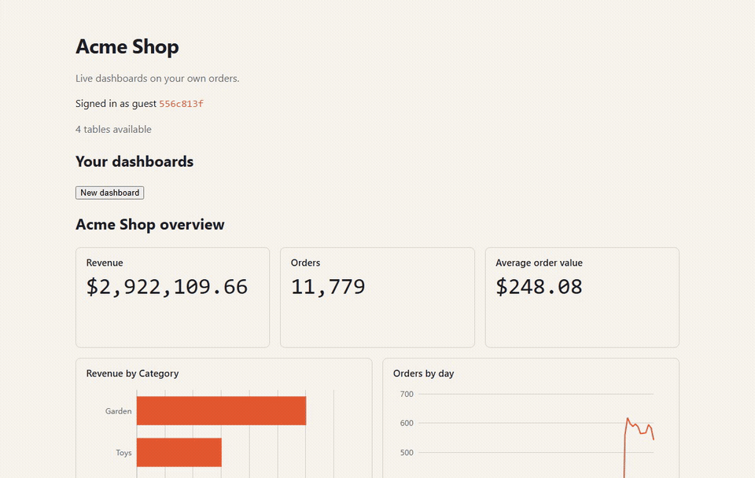
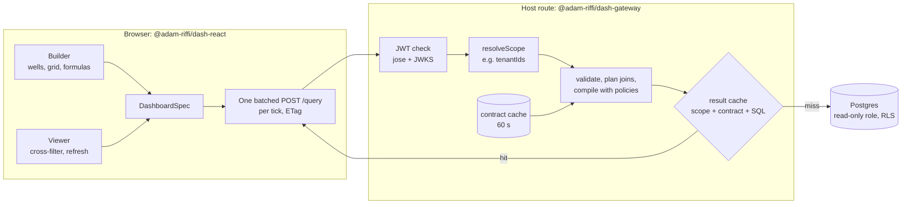
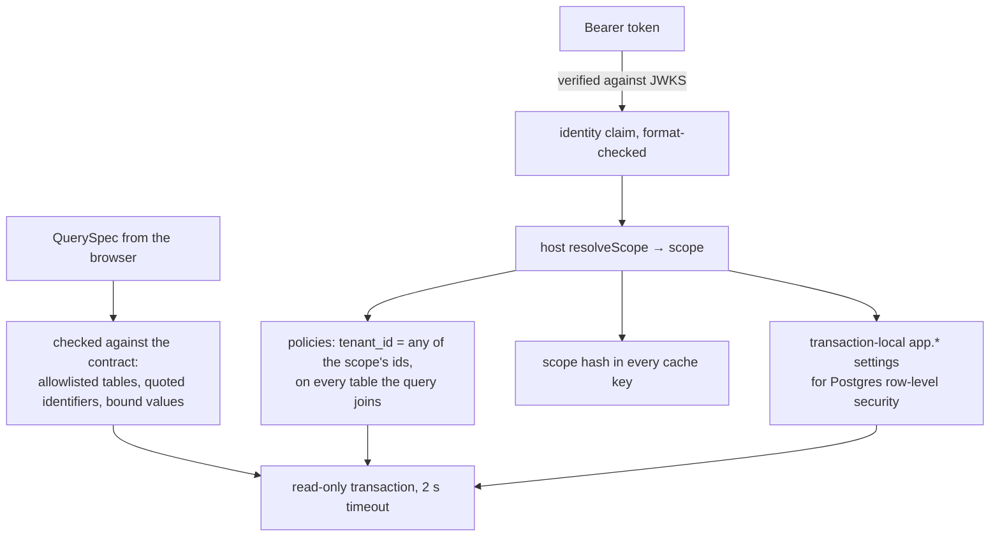

# dashboard-builder

**Let your app's users build live dashboards on their own data**: an embeddable gateway and React builder that never shows a user a row outside their scope.



**[Live demo](https://dashboard-builder-rose.vercel.app)** (you sign in as an anonymous guest of a fake shop) · [](https://github.com/adam-riffi/dashboard-builder/actions/workflows/ci.yml) [](LICENSE)

## Why it is interesting

- **Multi-tenant analytics without leaks.** Every query is compiled from a typed spec, never from SQL the browser sends.
  - The caller's JWT selects a security scope. Row policies are injected into each table the query joins, on top of Postgres row-level security.
  - The result cache is keyed by that scope. Property tests check that no random query, under any scope, returns another tenant's rows, including from the cache.
- **A hand-written core** where the work is:
  - contract inference from the database catalog;
  - join-path resolution with fan-out rejection;
  - policy injection;
  - a formula language (lexer, Pratt parser, type checker, SQL compiler);
  - cache keying and cross-filtering.

  Libraries only handle the edges: postgres.js, jose, zod, React, dnd-kit, react-grid-layout, CodeMirror, ECharts and TanStack Query.
- **Fast where it matters.** Cached queries answer in **15 ms at p95** (10 ms p50), against a 150 ms budget. Live dashboards refresh with `304`s when nothing changed.

## How it works



**Security model.** A user never chooses what they may see:



**Key algorithms**

- **Contract inference.** The allowlisted tables are read from `pg_catalog`. Column roles (id, time, measure, dimension) come from types, keys and statistics, and the relationships from foreign keys. The contract carries a schema hash, its version. Statistics stay on the server, since they ignore RLS.
- **Join paths.** A query's measures share one fact table. Every other table it reads is reached through many-to-one relationships, by the shortest unambiguous path. Paths that would fan out and double-count are refused.
- **Formulas.** `DIVIDE([Revenue], [Orders])` goes through a lexer, a Pratt parser and a checker. The checker assigns row or aggregate levels, inlines named measures, and reports errors at their spans. A renderer then emits SQL with casts and `nullif` for safe division.
- **Cache keys.** `sha256(scope hash, contract version, compiled SQL, parameters)`. The compiled SQL is keyed rather than the request, because two dashboards may give one measure name two meanings. An entry serves a request only while it is younger than that dashboard's refresh interval.
- **Cross-filtering.** A click becomes a filter on every other visual's query, while the clicked visual only highlights. A category gives an equality; a time point gives its period's `[start, next start)` in UTC.

## Benchmarks

`pnpm bench` signs in on the local stack CI runs (Next.js production build and Supabase) and times, from the browser:
- 15 uncached `POST /query` requests, each a distinct query;
- 25 cached requests for the demo's Revenue measure.

It fails if cached p95 reaches 150 ms. From [the M6 acceptance run](https://github.com/adam-riffi/dashboard-builder/pull/67#issuecomment-6241190336); later runs printed similar or lower numbers, e.g. cached p95 8–10 ms:

| Query | n | p50 | p95 |
| --- | --- | --- | --- |
| Uncached (cold instance included) | 15 | 21 ms | 284 ms |
| Cached | 25 | 10 ms | 15 ms |

On production, a reload within a dashboard's refresh interval answers every visual from the cache. The "Under the hood" drawer shows `cache hit, 0 ms`.

## Testing

- **Unit and property tests:** Vitest with fast-check. 15 properties run 100 cases each in CI and 1,000 each nightly (15,000 cases a night). They cover:
  - the parser round-trip;
  - SQL compilation;
  - hashing;
  - cache keys (the scope always changes the key);
  - the cross-filter coordinator (a visual is never filtered by its own selection).
- **Integration (CI Postgres):**
  - isolation and equivalence properties: random queries under random scopes must equal a plain TypeScript aggregation of only that scope's rows, run twice through a shared cache;
  - RLS on stored dashboards;
  - the gateway end to end.
- **Component tests:** Testing Library on jsdom, for wells, filters, the formula editor, previews, refresh and cross-filtering.
- **End to end:** Playwright against a production build and a local Supabase stack. It covers:
  - building and saving a dashboard;
  - cross-filtering by keyboard and by clicking a bar;
  - a new order appearing within the refresh interval;
  - the drawer;
  - screenshots compared with baselines made on a pinned Linux runner.
- **Published packages:** `pnpm check:packages` packs each package and checks its builds, types, README and license.

## Running locally

Needs Node 24, pnpm and Docker (for Supabase).

```bash
pnpm install
echo "[]" > supabase/signing_keys.json && pnpm exec supabase gen signing-key --algorithm ES256
pnpm exec supabase start
pnpm db:migrate && pnpm db:seed
pnpm dev
```

`pnpm exec supabase status` prints the URL and publishable key for `apps/demo/.env.local` (see `.env.example`). `pnpm check` runs lint, types, tests, builds and the package check. AGENTS.md lists every command.

To use the packages in your own app, see [`@adam-riffi/dash-gateway`](packages/gateway/README.md) and [`@adam-riffi/dash-react`](packages/react/README.md): host setup takes under 20 lines.

## Project structure

```
packages/core      schemas (DataContract, QuerySpec, DashboardSpec), the formula language
packages/gateway   contract inference, auth, policies, join planner, SQL compiler, caches, HTTP handler
packages/visuals   KPI, bar, line and table plugins; ECharts loaded lazily
packages/react     provider, viewer, cross-filter coordinator; the builder at /builder
apps/demo          "Acme Shop", the Next.js demo (anonymous sign-in, saved dashboards)
db                 Drizzle migrations, seed, RLS integration tests
docs               DESIGN.md, ENGINEERING.md, ADRs, the agent log
```

## Limitations and next steps

- **The result cache lives in each function instance's memory**, so hits come from warm instances. A shared store (Redis) is planned.
- **Selections another visual can't reach:** a selection on a field another visual has no path to turns that visual into an error. It should skip the filter instead.
- **Refresh requests:** after a selection, each refresh goes out as two requests instead of one.
- **Refresh is polling** with `304`s; server-sent events are planned.
- **npm:** the packages are ready to publish (Changesets, builds, READMEs) but are not on npm yet.
- **Next:** REST/JSON sources with DuckDB-WASM, CSV upload, time intelligence and more visuals (DESIGN.md §4, v1.1).

## License

[MIT](LICENSE)
